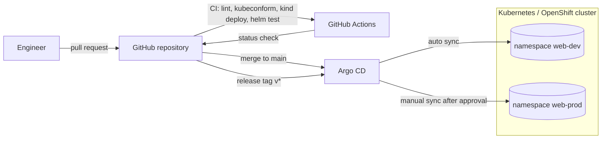

# Architecture

## Delivery flow

1. A change is proposed as a pull request. CI must pass before merge.
2. On merge to `main`, Argo CD automatically syncs **dev** and self-heals any drift.
3. A release is cut by tagging `main` (for example `v1.1.0`).
4. Production is promoted by changing `targetRevision` in `argocd/web-service-prod.yaml` to the new tag in a reviewed pull
   request, then syncing manually within the approved change window.
5. Rollback is a revert of that pull request (or `argocd app rollback web-service-prod`).

## Runtime layout

| Object | Dev | Prod |
| --- | --- | --- |
| Replicas | 1 | 3–10 (HPA on CPU) |
| PodDisruptionBudget | off | `minAvailable: 2` |
| NetworkPolicy | same release only | same release + `ingress-nginx` |
| Ingress | off | `web.example.com`, TLS, forced HTTPS |
